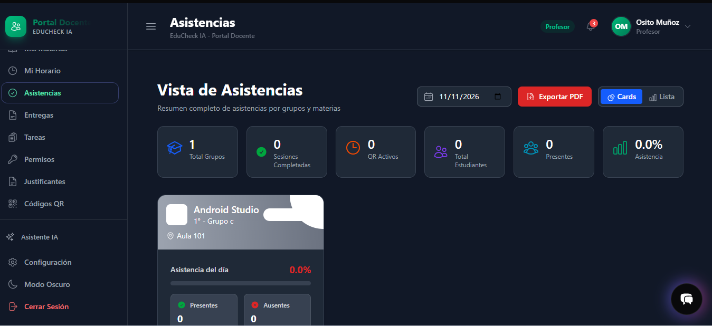
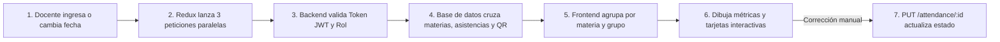

# Documentación Técnica: Módulo "Asistencias" (Portal Docente)

**Sistema:** EduCheck AI  
**Módulo:** Portal Docente &rarr; Asistencias / Vista de Asistencias  
**Ruta en la aplicación:** `/teacher/attendance`  
**Rol con acceso:** Docentes (`profesor`, `maestro`)  
**Stack principal:** React 19 + Tailwind CSS 4, Redux Toolkit, Node.js + Express, PostgreSQL  

## 1. ¿Qué es este módulo y para qué sirve?

El módulo **"Asistencias"** es el panel de control diario del profesor para supervisar, registrar y auditar la presencia de sus alumnos en clases. Permite consultar el pase de lista de cualquier fecha seleccionada, visualizar en tiempo real qué grupos tienen sesiones de código QR activas, revisar métricas de asistencia general y modificar manualmente el estado de cualquier estudiante (presente, ausente, retardo o justificado) ante eventualidades.

Además, cuenta con una herramienta integrada para generar y descargar reportes oficiales en formato PDF filtrados por materia, grupo o estudiante.


{: width="860px"}


## 2. Mapa Visual de la Pantalla

A continuación se muestra la organización de la pantalla principal (`AttendanceOverview.jsx`) y sus componentes complementarios:

```
+----------------------------------------------------------------------------------------------------+
| BARRA SUPERIOR (Navbar)                                                                            |
| [=] Vista de Asistencias | EduCheck IA - Portal Docente     [Profesor]  [(3)] [OM] Osito Muñoz (v) |
+---------------------+------------------------------------------------------------------------------+
| MENÚ LATERAL        | ÁREA DE CONTENIDO (AttendanceOverview.jsx)                                   |
|                     |                                                                              |
| [Logo] Portal       | Vista de Asistencias           [Fecha: 2026-11-11] [Exportar PDF] [Cards|Lista]
|        Docente      | Resumen completo de asistencias por grupos y materias                        |
|                     |                                                                              |
| ( ) Dashboard       | +-------------+-------------+-------------+-------------+-------------+----+ |
| ( ) Mis Alumnos     | | Total Grupos| Sesiones OK | QR Activos  | Total Alumn | Presentes   | %  | |
| ( ) Mis Materias    | |     4       |      2      |      1      |     35      |     30      |85.7| |
| ( ) Mi Horario      | +-------------+-------------+-------------+-------------+-------------+----+ |
| [*] Asistencias     |                                                                              |
| ( ) Entregas        | +-----------------------------------------+  +-----------------------------+ |
| ( ) Tareas          | | [Cap] Android Studio - 1° Grupo C (QR)  |  | Matemáticas - 2° Grupo A    | |
| ( ) Permisos        | | Asistencia: 90% [===========--]         |  | Asistencia: 75% [========--]| |
|                     | | Presentes: 18 | Ausentes: 2             |  | Presentes: 12 | Ausentes: 4 | |
| ( ) Asistente IA    | | Aula 3                        (Ver ->)  |  | Aula 1             (Ver ->) | |
| ( ) Configuración   | +-----------------------------------------+  +-----------------------------+ |
| ( ) Modo Oscuro     |                                                                              |
| (x) Cerrar Sesión   |  * Clic en tarjeta -> Modal de Detalle (filtro y edición manual de estado)   |
|                     |  * Clic en "Exportar PDF" -> Modal de generación de reportes por rango/tipo  |
+---------------------+------------------------------------------------------------------------------+
```

### Elementos principales de la pantalla:
1. **Controles de Cabecera:**
   - **Selector de Fecha (`CalendarDaysIcon`):** Input tipo calendario para consultar asistencias históricas o del día en curso.
   - **Botón Exportar PDF (`DocumentArrowDownIcon`):** Despliega el modal de descarga de reportes oficiales.
   - **Selector de Vista:** Alterna la presentación entre cuadrícula interactiva (*Cards*) y tabla estructurada (*Lista*).
2. **Tablero de Métricas Rápidas (6 KPIs):**
   - **Total Grupos:** Número de clases asignadas al docente.
   - **Sesiones Completadas:** Grupos con registro de asistencia cerrado.
   - **QR Activos:** Sesiones donde los alumnos pueden escanear su código en ese instante.
   - **Total Estudiantes:** Suma de alumnos inscritos en los grupos del día.
   - **Presentes:** Estudiantes con registro exitoso.
   - **% Asistencia:** Tasa porcentual global del día.
3. **Tarjetas de Grupo (`AttendanceGroupCard.jsx`):**
   - Encabezado con gradiente según el estado (*Activo con QR*, *Completado* o *Pendiente*).
   - Materia, grado, grupo y aula asignada.
   - Barra de progreso porcentual dinámica (verde si &ge; 80%, amarillo si &ge; 60%, rojo si &lt; 60%).
   - Conteo detallado de presentes, ausentes, retardos y justificados.
4. **Modal de Detalle (`AttendanceDetailModal.jsx`):**
   - Lista completa de los alumnos del grupo seleccionado con su matrícula y hora de escaneo.
   - Buscador por nombre/matrícula y filtro por estado.
   - Edición manual: Permite al profesor cambiar el estado de un alumno y guarda la corrección de inmediato en la base de datos.

---

## 3. ¿Cómo funciona por dentro? (Flujo de Datos)

El intercambio de datos entre la vista del docente, Redux y PostgreSQL se organiza así:



### Paso a paso del ciclo:
1. **Inicio de la vista:** Al montar o cambiar la fecha, `AttendanceOverview.jsx` despacha tres acciones simultáneas:
   - `getTeacherSubjects()`: Obtiene las materias y grupos que imparte el docente.
   - `getActiveQRCodes()`: Verifica qué códigos QR están vigentes.
   - `getAllAttendances({ fecha })`: Descarga los registros de asistencia del día.
2. **Validación de identidad:** El servidor valida mediante `protect` y `teacher` que la petición provenga de un profesor autenticado.
3. **Consulta relacional en PostgreSQL:** El backend busca los registros asegurando que pertenezcan a materias del docente (`m.teacher_id = ?`).
4. **Consolidación en el cliente:** Mediante `useMemo`, el frontend cruza las materias con sus asistencias y códigos QR activos, generando los grupos estructurados y calculando los 6 indicadores globales.
5. **Actualización en vivo:** Si el docente ajusta manualmente la asistencia de un estudiante desde el modal, se ejecuta un `PUT` directo que actualiza el estado en PostgreSQL y refresca la UI al instante sin recargar la página.

---

## 4. Estructura del Backend (Lado del Servidor)

El backend maneja las asistencias bajo el patrón **MVC** con validaciones estrictas de propiedad.

### 4.1 Endpoints del módulo

| Método | Endpoint | Middleware | ¿Qué hace? |
| :--- | :--- | :--- | :--- |
| `GET` | `/api/teacher/attendance/all?fecha=YYYY-MM-DD` | `protect`, `teacher` | Retorna todos los registros individuales de asistencia del profesor en la fecha indicada. |
| `GET` | `/api/teacher/attendance/summary?fecha=YYYY-MM-DD` | `protect`, `teacher` | Retorna el resumen consolidado por materia y grupo con conteos agregados. |
| `PUT` | `/api/teacher/attendance/:asistenciaId` | `protect`, `teacher` | Modifica el estado de asistencia de un alumno (presente, ausente, retardo, justificado). |
| `GET` | `/api/teacher/pdf/export/subject/:materiaId` | `protect`, `teacher` | Genera y descarga el reporte PDF de asistencias de una materia por rango de fechas. |

### 4.2 La regla de oro de la seguridad (Aislamiento de asistencias)
En `teacherAttendanceController.js`, ningún docente puede consultar ni modificar asistencias de otros grupos:
1. **Resolución de Identidad:** Obtiene el `profesorId` a partir de `req.user.user_id` almacenado en el token JWT verificado:
   ```sql
   SELECT teacher_id FROM teachers WHERE user_id = ?
   ```
2. **Filtrado estricto en consultas:** Todos los reportes exigen que la materia esté a su cargo (`WHERE m.teacher_id = ?`).
3. **Verificación previa a la modificación:** Antes de aplicar cualquier `UPDATE`, el controlador confirma que el registro pertenezca a una clase del profesor:
   ```sql
   SELECT a.attendance_id
   FROM attendances a
   INNER JOIN enrollments i ON a.enrollment_id = i.enrollment_id
   INNER JOIN subjects m ON i.subject_id = m.subject_id
   WHERE a.attendance_id = ? AND m.teacher_id = ?
   ```
   Si no existe relación entre el registro y el profesor, el servidor responde con `403 No tienes autorización para modificar esta asistencia`.

---

## 5. Estructura del Frontend (Lado del Cliente)

El módulo se encuentra en el dominio de profesores (`frontend/src/domains/teachers/`):

### 5.1 Enrutamiento y Protección
- **Archivo:** `core/router/index.js`
- **Ruta declarada:** `/teacher/attendance` (carga diferida de `AttendanceOverview.jsx`).
- **Protección (`ProtectedRoute.jsx`):** Requiere sesión activa y roles autorizados `['profesor', 'maestro']`.

### 5.2 Servicio de API (`teacherAttendanceService.js` y `teacherPdfService.js`)
- `getAllAttendances(fecha)`: Consulta `/api/teacher/attendance/all` con Axios e inyecta las cabeceras de autorización (`getHeaders()`).
- `updateAttendanceStatus(asistenciaId, estado)`: Envía la actualización manual mediante `PUT`.
- `teacherPdfService`: Maneja la descarga de archivos Blob (`application/pdf`) y dispara la descarga en el navegador con nombres estructurados (`asistencias_materia_YYYY-MM-DD.pdf`).

### 5.3 Gestión de Estado Global con Redux (`teacherAttendanceSlice.js`)
El slice centraliza el estado de la vista bajo `teacherAttendance`:
- `attendances`: Lista plana de asistencias recibidas de la base de datos.
- `subjects`: Catálogo de materias y grupos asignados.
- `activeQRs`: Sesiones activas de código QR en tiempo real.
- `isLoading` y `error`: Indicadores de estado de red.

### 5.4 Componentes de la Vista
1. **Vista Principal (`AttendanceOverview.jsx`):** Orquestador general; maneja la fecha seleccionada, calcula las métricas con `useMemo` y conmuta entre vistas de tarjeta y lista.
2. **Tarjeta de Grupo (`AttendanceGroupCard.jsx`):** Componente visual de alto impacto que dibuja el porcentaje de asistencia con una barra de color adaptable y badges dinámicos.
3. **Modal de Detalle (`AttendanceDetailModal.jsx`):** Permite filtrar estudiantes, auditar la hora exacta de escaneo y editar estados en vivo.
4. **Modal de Exportación (`ExportPdfModal.jsx`):** Formulario para definir tipo de reporte (por materia, por alumno o por grupo) y rango de fechas antes de generar el documento.

---

## 6. Guía Rápida de Archivos para Desarrolladores

Para revisar o modificar cualquier funcionalidad de asistencias, consulta los siguientes archivos:

| Capa | Archivo | Responsabilidad |
| :--- | :--- | :--- |
| **Backend: Rutas Asistencia** | `backend/routes/teacher/teacher.index.routes.js` | Endpoints de consulta y actualización de asistencias con middlewares `protect` y `teacher`. |
| **Backend: Rutas PDF** | `backend/routes/teacher/pdf.routes.js` | Endpoints especializados en generación y streaming de reportes en PDF. |
| **Backend: Controlador** | `backend/controllers/teacher/teacherAttendanceController.js` | Consultas agregadas con JOINs, cálculo de presentes/ausentes y validación de permisos de edición. |
| **Frontend: Pantalla Principal** | `frontend/src/domains/teachers/pages/ViewTeacher/AttendanceOverview.jsx` | Dashboard general con selector de fecha, 6 métricas y conmutador cards/lista. |
| **Frontend: Tarjeta de Clase** | `frontend/src/domains/teachers/components/ViewTeacher/AttendanceGroupCard.jsx` | Tarjeta resumen de cada grupo con barra de progreso y estado QR. |
| **Frontend: Modal Detalle** | `frontend/src/domains/teachers/components/ViewTeacher/AttendanceDetailModal.jsx` | Lista de alumnos con búsqueda, filtros y edición manual de estados. |
| **Frontend: Modal PDF** | `frontend/src/domains/teachers/components/ViewTeacher/ExportPdfModal.jsx` | Modal interactivo para configurar y solicitar reportes PDF. |
| **Frontend: Estado** | `frontend/src/domains/teachers/store/teacherAttendanceSlice.js` | Slice de Redux Toolkit para asistencias, materias y QRs activos. |
| **Frontend: Servicio** | `frontend/src/domains/teachers/services/teacherAttendanceService.js` | Peticiones HTTP hacia la API de asistencias. |

