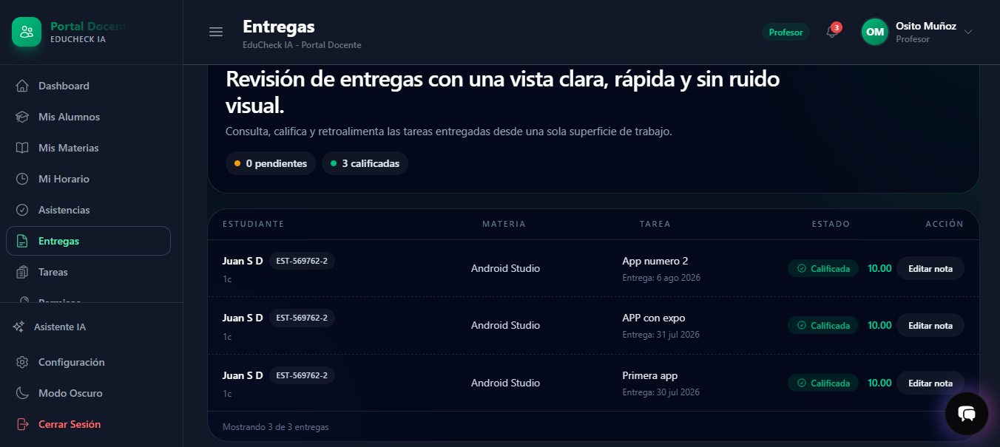
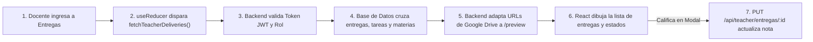

# Documentación Técnica: Módulo "Entregas" (Portal Docente)

**Sistema:** EduCheck AI  
**Módulo:** Portal Docente &rarr; Entregas / Revisión de Tareas  
**Ruta en la aplicación:** `/teacher/surrender`  
**Rol con acceso:** Docentes (`profesor`, `maestro`)  
**Stack principal:** React 19 + Tailwind CSS 4, useReducer (Estado local reactivo), Node.js + Express, PostgreSQL  

## 1. ¿Qué es este módulo y para qué sirve?

El módulo **"Entregas"** es el espacio de evaluación y retroalimentación académica del profesor en EduCheck AI. En este panel, el docente centraliza todos los trabajos, tareas y proyectos enviados por sus estudiantes a través de las materias que imparte.

El módulo permite filtrar rápidamente entre tareas pendientes y calificadas, revisar la fecha exacta de envío, acceder a los archivos adjuntos (con soporte automático para previsualizaciones de Google Drive) y calificar asignando una nota numérica junto con comentarios de retroalimentación en un modal interactivo.


{: width="860px"}

### Elementos principales de la pantalla:
1. **Encabezado y Resumen Rápido:**
   - **Insignia identificadora:** Píldora verde esmeralda con icono de portapapeles (`ClipboardDocumentListIcon`).
   - **Contador global:** Total de entregas registradas en las materias del docente.
   - **Indicadores de estado:** Conteo dinámico de tareas pendientes (punto ámbar) y tareas calificadas (punto verde).
   - **Botón "Actualizar":** Dispara una resincronización en vivo con el backend (`loadDeliveries`) con animación de giro (`ArrowPathIcon`).
2. **Listado Estructurado de Entregas:**
   - **Columna Estudiante:** Nombre completo, matrícula escolar y grupo en texto secundario.
   - **Columna Materia:** Nombre de la asignatura a la que pertenece la actividad.
   - **Columna Tarea:** Título de la tarea asignada y fecha en que el estudiante realizó la entrega.
   - **Columna Estado y Nota:** Badge indicador (*Calificada* con nota visible o *Pendiente*).
   - **Columna Acción:** Botón adaptable que muestra *"Calificar"* (estilo verde esmeralda destacado) o *"Editar nota"* (estilo secundario suave).
3. **Modal de Calificación (`GradeDeliveryModal.jsx`):**
   - Tarjeta informativa del estudiante y la tarea.
   - Enlace directo al archivo adjunto (`archivo_ruta`) con apertura segura en nueva pestaña (`target="_blank"`).
   - Selector interactivo por estrellas (para actividades con escala de hasta 10 puntos).
   - Campo numérico con validación de rango (de 0 al puntaje máximo permitido).
   - Campo de retroalimentación (*feedback*) para observaciones pedagógicas.
   - Alerta flotante (*Toast*) de confirmación de guardado.

---

## 3. ¿Cómo funciona por dentro? (Flujo de Datos)

El flujo de información para consultar y calificar entregas sigue estos pasos:



### Paso a paso:
1. **Carga inicial:** `TeacherDeliveriesPage.jsx` inicializa su estado con `useReducer` y llama a `fetchTeacherDeliveries()` a través del servicio.
2. **Autenticación segura:** La solicitud viaja a `/api/teacher/entregas` con la cabecera `Authorization: Bearer <token>`.
3. **Aislamiento en Base de Datos:** El servidor identifica al profesor por su token y busca únicamente las entregas vinculadas a materias bajo su titularidad (`m.teacher_id = ?`).
4. **Optimización de enlaces:** El backend convierte automáticamente enlaces de Google Drive en modo visualizable (`/preview`).
5. **Renderizado reactivo:** La lista se almacena en el estado local; los filtros de texto, estado y materia se aplican en memoria de forma instantánea.
6. **Guardado de calificación:** Al enviar el formulario del modal, se envía un `PUT` a `/api/teacher/entregas/:id` con la nota y comentarios. Al responder exitosamente, el estado local actualiza la entrega sin necesidad de recargar toda la página.

---

## 4. Estructura del Backend (Lado del Servidor)

El backend implementa el patrón **MVC** y expone las rutas del módulo en `backend/routes/teacher/teacherDeliveries.routes.js`.

### 4.1 Endpoints del módulo

| Método | Endpoint | Middleware | ¿Qué hace? |
| :--- | :--- | :--- | :--- |
| `GET` | `/api/teacher/entregas` | `protect`, `teacher` | Retorna todas las entregas de las materias que imparte el profesor. |
| `GET` | `/api/teacher/entregas/tarea/:tarea_id` | `protect`, `teacher` | Retorna las entregas de una tarea específica previa validación de titularidad. |
| `GET` | `/api/teacher/entregas/:entrega_id` | `protect`, `teacher` | Retorna el detalle completo de una entrega específica. |
| `PUT` | `/api/teacher/entregas/:entrega_id` | `protect`, `teacher` | Asigna o modifica la calificación (`grade`) y comentarios (`feedback`). |
| `DELETE` | `/api/teacher/entregas/:entrega_id` | `protect`, `teacher` | Elimina un registro de entrega si pertenece a una materia del profesor. |

### 4.2 Seguridad y Lógica de Negocio
En `teacherDeliveriesController.js`:
1. **Resolución de Identidad:** Obtiene el `profesor_id` del token JWT verificado:
   ```sql
   SELECT teacher_id FROM teachers WHERE user_id = ?
   ```
2. **Consulta con JOINs y Scoping:**
   ```sql
   SELECT en.*, 
          t.title AS tarea_titulo,
          m.name AS materia_nombre,
          e.student_number, e.grade, e.section,
          u.first_name AS estudiante_nombre, u.last_name AS "estudiante_apellidoP", 
          u.second_last_name AS "estudiante_apellidoM", u.email AS estudiante_email
   FROM submissions en
   JOIN assignments t ON en.assignment_id = t.assignment_id
   JOIN subjects m ON t.subject_id = m.subject_id
   JOIN students e ON en.student_id = e.student_id
   JOIN users u ON e.user_id = u.user_id
   WHERE m.teacher_id = ?
   ORDER BY en.submitted_at DESC
   ```
3. **Conversión inteligente de Google Drive (`formatDrivePreviewUrl`):** Detecta enlaces tipo `drive.google.com/file/d/.../view` y los transforma a `/preview` para que puedan visualizarse sin problemas de bloqueo en navegadores modernos.
4. **Validación previa a calificar:** Antes de actualizar una nota con `UPDATE submissions`, el backend confirma que la entrega pertenezca a una materia del docente (`WHERE en.submission_id = ? AND m.teacher_id = ?`). Si no coincide, retorna `403 No autorizado`.

---

## 5. Estructura del Frontend (Lado del Cliente)

El módulo se encuentra en el dominio de profesores (`frontend/src/domains/teachers/`):

### 5.1 Enrutamiento y Protección
- **Archivo:** `core/router/index.js`
- **Ruta declarada:** `/teacher/surrender` (carga diferida de `TeacherDeliveriesPage.jsx`).
- **Protección (`ProtectedRoute.jsx`):** Requiere sesión activa y valida roles `['profesor', 'maestro']`.
- **Menú de navegación:** Enlazado en `menuItems.js` con el texto *"Entregas"* y el icono `DocumentTextIcon`.

### 5.2 Servicio de API (`teacherDeliveriesService.js`)
- Expone `fetchTeacherDeliveries()`, `fetchTeacherDeliveryById()`, `gradeDelivery()` y `deleteDelivery()`.
- Utiliza `fetchWithTimeout` inyectando el token JWT con `getHeaders()` y gestiona caídas de sesión mediante `handleResponse`.

### 5.3 Gestión de Estado Ágil con `useReducer`
A diferencia de otros módulos que usan Redux global, este módulo implementa un patrón de **estado local con `useReducer`** en `TeacherDeliveriesPage.jsx`:
- **Ventaja arquitectónica:** Mantiene el estado de la lista, los filtros y la apertura del modal contenidos dentro de la pantalla, evitando sobrecargar el store global con datos transitorios.
- **Acciones principales:** `SET_DATA`, `SET_LOADING`, `SET_ERROR`, `OPEN_MODAL`, `CLOSE_MODAL`, `GRADE_SUCCESS` y `SET_TOAST`.
- **Filtrado en memoria (`applyFilters`):** Cruza en tiempo real el término de búsqueda con el estado (*pendiente* o *calificada*) y la materia seleccionada sin realizar llamadas repetitivas al servidor.

### 5.4 Componentes de la Vista
1. **Página Principal (`TeacherDeliveriesPage.jsx`):** Contenedor principal con diseño Dark Mode envolvente, indicadores de tareas pendientes/calificadas y tabla responsiva.
2. **Modal de Calificación (`GradeDeliveryModal.jsx`):** Formulario controlado con validación de puntaje, selección por estrellas, visualización del archivo adjunto y alertas de error en caso de notas inválidas.

---

## 6. Guía Rápida de Archivos para Desarrolladores

Para revisar, depurar o extender este módulo, consulta los siguientes archivos:

| Capa | Archivo | Responsabilidad |
| :--- | :--- | :--- |
| **Backend: Rutas** | `backend/routes/teacher/teacherDeliveries.routes.js` | Rutas REST de entregas bajo `/api/teacher/entregas` con middlewares `protect` y `teacher`. |
| **Backend: Controlador** | `backend/controllers/teacher/teacherDeliveriesController.js` | Consultas SQL de entregas, formateo de URLs de Google Drive y lógica de calificación. |
| **Backend: Seguridad** | `backend/middleware/authMiddleware.js` | Autenticación JWT (`protect`) y autorización de rol docente (`teacher`). |
| **Frontend: Pantalla Principal** | `frontend/src/domains/teachers/pages/ViewTeacher/TeacherDeliveriesPage.jsx` | Interfaz de lista de entregas, métricas de pendientes/calificadas y reducer local. |
| **Frontend: Modal Calificar** | `frontend/src/domains/teachers/components/ViewTeacher/GradeDeliveryModal.jsx` | Modal interactivo para evaluar la entrega, revisar archivo y dejar feedback. |
| **Frontend: Servicio** | `frontend/src/domains/teachers/services/teacherDeliveriesService.js` | Funciones HTTP (`GET`, `PUT`, `DELETE`) hacia la API de entregas. |
| **Frontend: Enrutamiento** | `frontend/src/core/router/index.js` | Registro de la ruta protegida `/teacher/surrender`. |

