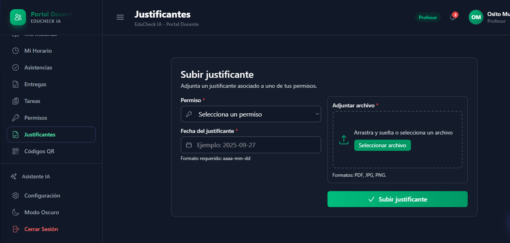

# Documentación Técnica: Módulo "Justificantes" (Portal Docente)

**Sistema:** EduCheck AI  
**Módulo:** Portal Docente &rarr; Justificantes / Carga de Evidencia  
**Ruta en la aplicación:** `/teacher/justificantes/upload`  
**Rol con acceso:** Docentes (`profesor`, `maestro`)  
**Stack principal:** React 19 + Tailwind CSS 4, Multer + Google Drive Cloud Storage, Node.js + Express, PostgreSQL  

## 1. ¿Qué es este módulo y para qué sirve?

El módulo **"Justificantes"** es la herramienta complementaria de respaldo documental del profesor en EduCheck AI. Permite adjuntar y respaldar digitalmente las evidencias físicas (certificados médicos, oficios de comisión, constancias legales o trámites oficiales) asociadas a una solicitud de permiso previamente registrada.

El módulo integra una zona de arrastrar y soltar (*drag & drop*), previsualización inmediata de comprobantes en imagen o indicador PDF, validación de formatos admitidos y almacenamiento seguro en la nube a través de la API de Google Drive, vinculando de forma automática el enlace de visualización generado con la base de datos institucional.

{: width="860px"}

### Elementos principales de la pantalla:
1. **Selector de Permiso Vinculado:**
   - Menú desplegable (`select`) con icono de llave (`KeyIcon`) que lista los permisos del docente (ejemplo: `2026-11-20 — Cita médica`), asegurando que ningún justificante quede huérfano.
2. **Fecha del Comprobante:**
   - Campo de texto con icono de calendario (`CalendarIcon`), validado bajo el patrón estricto `aaaa-mm-dd`.
3. **Zona de Carga y Arrastre (Drag & Drop):**
   - Recuadro delimitado por borde discontinuo (`border-dashed hover:border-emerald-400`) con icono de carga (`ArrowUpTrayIcon`).
   - Admite selección tradicional mediante explorador de archivos o arrastre directo sobre la superficie.
   - **Previsualización dinámica:** Muestra una miniatura de la imagen cargada (`URL.createObjectURL`) o una tarjeta con la etiqueta `PDF`, acompañada del nombre del archivo y un enlace para descartarlo (*"Eliminar"*).
   - Formatos permitidos: `.pdf`, `.jpg`, `.jpeg`, `.png`.
4. **Botón de Envío y Alertas:**
   - Botón gradiente verde esmeralda (`from-emerald-500 to-emerald-600`) que cambia a estado de espera (*"Subiendo..."*) durante la transferencia.
   - Mensajes flotantes de alerta: verde con `CheckCircleIcon` ante subida exitosa, o rojo con `ExclamationTriangleIcon` ante fallas de validación o red.
5. **Navegación General (Sidebar y Navbar):**
   - Menú lateral con **Justificantes** (`DocumentTextIcon`) activo.
   - Barra superior con títulos sincronizados y perfil docente ("Osito Muñoz").

---

## 3. ¿Cómo funciona por dentro? (Flujo de Datos)

El proceso integral de transferencia y almacenamiento del comprobante sigue estos pasos:

```mermaid
flowchart LR
    A["1. Docente adjunta archivo y permiso"] --> B["2. Frontend empaqueta FormData"]
    B --> C["3. Multer valida tamaño y extensión"]
    C --> D["4. Backend comprueba que el permiso sea suyo"]
    D --> E["5. Envía archivo a Google Drive API"]
    E --> F["6. fs.unlink borra archivo temporal del servidor"]
    F --> G["7. Guarda URL de Drive en PostgreSQL"]
    G --> H["8. Notifica éxito y refresca la UI"]
```



### Paso a paso:
1. **Selección del comprobante:** El profesor selecciona el permiso de su lista, indica la fecha del documento y adjunta el comprobante.
2. **Empaquetado FormData:** El servicio `justificationService.js` genera un objeto `FormData` con `permiso_id`, `fecha` y el archivo binario (`file`).
3. **Recepción con Multer:** El middleware `uploadMiddleware.js` recibe el archivo, comprueba el tipo MIME (`image/*` o `application/pdf`) y lo almacena temporalmente en el disco del servidor.
4. **Verificación de Propiedad:** El controlador `teacherJustificationController.js` valida que el `permiso_id` exista y pertenezca al profesor autenticado (`teacher_id`), evitando inyecciones de comprobantes en permisos ajenos.
5. **Carga en Cloud Storage (Google Drive):** El backend abre un flujo de lectura (`fs.createReadStream`) y sube el archivo a Google Drive mediante la librería oficial de Google APIs.
6. **Configuración de Permisos en la Nube:** Asigna permisos de lectura al archivo para que los administradores y directores puedan visualizarlo directamente desde el panel escolar sin barreras de acceso.
7. **Limpieza en Servidor:** Ejecuta `fsPromises.unlink()` para eliminar de inmediato el archivo temporal del servidor local, optimizando el uso de disco.
8. **Persistencia en Base de Datos:** Guarda el enlace generado (`webViewLink`) en la tabla `leave_justifications` y responde con código HTTP 201.

---

## 4. Estructura del Backend (Lado del Servidor)

El backend maneja la recepción y el almacenamiento en la nube bajo el patrón **MVC**:

### 4.1 Endpoint del módulo

| Método | Endpoint | Middleware | ¿Qué hace? |
| :--- | :--- | :--- | :--- |
| `POST` | `/api/teacher/justificaciones` | `protect`, `teacher`, `upload.single('file')` | Recibe el archivo de evidencia, lo sube a Google Drive y registra la URL vinculada al permiso en PostgreSQL. |

### 4.2 Lógica de Negocio y Seguridad
En `teacherJustificationController.js`:
1. **Validación de Parámetros:** Exige que el `permiso_id` y el archivo binario vengan presentes en el cuerpo de la petición.
2. **Scoping Estricto por Docente:**
   ```sql
   SELECT leave_request_id 
   FROM leave_requests 
   WHERE leave_request_id = ? AND teacher_id = ?
   ```
   Si el permiso no existe o pertenece a otro profesor, cancela la operación con `404 Permiso no encontrado o no pertenece al profesor`.
3. **Manejo Resiliente de Archivos Temporales:** Si la subida a la nube falla por intermitencias del servicio externo, un bloque `try/catch` garantiza que el archivo temporal en disco sea eliminado para prevenir fugas de almacenamiento local.
4. **Registro en PostgreSQL:**
   ```sql
   INSERT INTO leave_justifications (leave_request_id, file_url, uploaded_at) 
   VALUES (?, ?, ?)
   ```
   Almacena la URL pública segura (`webViewLink`) y la marca de tiempo de la subida.

---

## 5. Estructura del Frontend (Lado del Cliente)

El frontend está estructurado en el dominio de profesores (`frontend/src/domains/teachers/`):

### 5.1 Enrutamiento y Protección
- **Archivo:** `core/router/index.js`
- **Ruta declarada:** `/teacher/justificantes/upload` (carga diferida de `UploadJustificante.jsx`).
- **Protección (`ProtectedRoute.jsx`):** Requiere sesión activa y permisos autorizados `['profesor', 'maestro']`.
- **Menú de navegación:** Enlazado en `menuItems.js` con el texto *"Justificantes"* y el icono `DocumentTextIcon`.

### 5.2 Servicio de API (`justificationService.js`)
- `uploadJustification({ permiso_id, file, fecha })`:
  - Construye el `FormData`.
  - Configura un tiempo de espera extendido (`UPLOAD_TIMEOUT_MS = 60 * 60 * 1000`) para soportar archivos de gran tamaño sin cancelaciones prematuras.
  - Elimina deliberadamente el encabezado manual `Content-Type` para permitir que el navegador calcule el `boundary` de multipart automáticamente, preservando la cabecera `Authorization: Bearer <token>`.

### 5.3 Componente de Vista (`UploadJustificante.jsx`)
- **Sincronización con Permisos:** Se conecta al store de Redux (`teacherPermissionSlice`) para consultar la lista actualizada de permisos del docente y poblar el desplegable de vinculación.
- **Manejo de Drag & Drop:** Controla eventos nativos `onDragOver` y `onDrop` con validación de extensiones y tamaño.
- **Gestión de Memoria en Previsualización:** Utiliza `URL.createObjectURL(file)` para generar miniaturas instantáneas de imágenes y ejecuta `URL.revokeObjectURL()` al desmontar o sustituir el archivo para evitar fugas de memoria.
- **Feedback Integral:** Limpia los campos del formulario y actualiza el listado de permisos en Redux tras una subida exitosa.

---

## 6. Guía Rápida de Archivos para Desarrolladores

Para revisar, depurar o extender este módulo, consulta los siguientes archivos clave:

| Capa | Archivo | Responsabilidad |
| :--- | :--- | :--- |
| **Backend: Rutas** | `backend/routes/teacher/teacherJustification.routes.js` | Expone la ruta `POST /` con `uploadMiddleware.single('file')`. |
| **Backend: Subida Multer** | `backend/middleware/uploadMiddleware.js` | Configuración de almacenamiento temporal en disco y filtro de tipos (PDF e imágenes). |
| **Backend: Servicio Cloud** | `backend/config/googleDrive.js` | Inicialización y autenticación del cliente de Google Drive API. |
| **Backend: Controlador** | `backend/controllers/teacher/teacherJustificationController.js` | Verificación de titularidad del permiso, subida a Drive, limpieza local e inserción en PostgreSQL. |
| **Backend: Seguridad** | `backend/middleware/authMiddleware.js` | Validación de token JWT (`protect`) y rol docente (`teacher`). |
| **Frontend: Pantalla** | `frontend/src/domains/teachers/pages/ViewTeacher/UploadJustificante.jsx` | Interfaz de carga con drag & drop, previsualización de imágenes y selección de permiso. |
| **Frontend: Servicio** | `frontend/src/domains/teachers/services/justificationService.js` | Envío de `FormData` con timeout extendido y cabeceras de autorización. |
| **Frontend: Enrutamiento** | `frontend/src/core/router/index.js` | Registro de la ruta protegida `/teacher/justificantes/upload`. |
