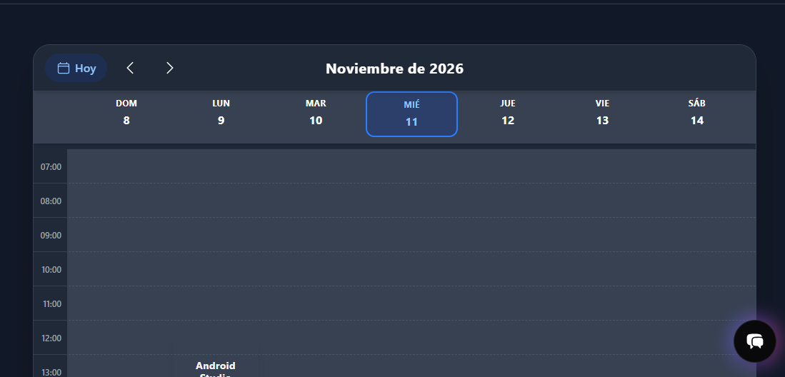
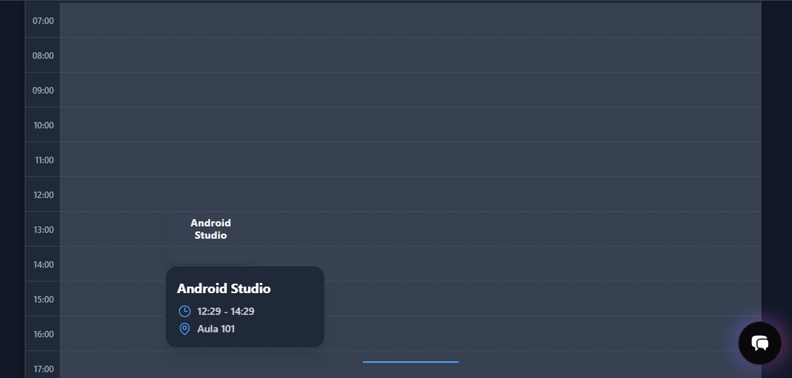
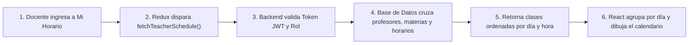

# Documentación Técnica: Módulo "Mi Horario" (Portal Docente)

**Sistema:** EduCheck AI  
**Módulo:** Portal Docente &rarr; Mi Horario / Planificador Semanal  
**Ruta en la aplicación:** `/teacher/schedule`  
**Rol con acceso:** Docentes (`profesor`, `maestro`)  
**Stack principal:** React 19 + Tailwind CSS 4, Redux Toolkit, Node.js + Express, PostgreSQL  

## 1. ¿Qué es este módulo y para qué sirve?

El módulo **"Mi Horario"** es la agenda académica interactiva del profesor dentro del portal docente. Proporciona una vista semanal tipo calendario donde el docente consulta de forma gráfica y cronológica sus clases programadas, las aulas asignadas y los rangos de horario de cada jornada (de domingo a sábado).

La pantalla cuenta con navegación por semanas, detección en tiempo real de la hora del día, bloques de materias con colores distintivos automáticos y ventanas emergentes (*popovers*) con los detalles de cada clase al hacer clic.

{: width="860px"}

{: width="860px"}

## 2. Mapa Visual de la Pantalla

A continuación se muestra cómo se estructura visualmente el calendario y qué elementos componen su interfaz:

```
+----------------------------------------------------------------------------------------------------+
| BARRA SUPERIOR (Navbar)                                                                            |
| [=] Mi Horario | EduCheck IA - Portal Docente              [Profesor]  [(3)] [OM] Osito Muñoz (v)  |
+---------------------+------------------------------------------------------------------------------+
| MENÚ LATERAL        | ÁREA DE CONTENIDO (teacherSchedulesList.jsx)                                 |
|                     |                                                                              |
| [Logo] Portal       | +--------------------------------------------------------------------------+ |
|        Docente      | | [Hoy]  (<) (>)            Noviembre de 2026                              | |
|                     | +--------------------------------------------------------------------------+ |
| ( ) Dashboard       | | HORA  |  DOM 8  |  LUN 9  | MAR 10  | MIÉ 11  | JUE 12  | VIE 13  | SÁB 14 | |
| ( ) Mis Alumnos     | |-------+---------+---------+---------+---------+---------+---------+--------| |
| ( ) Mis Materias    | | 07:00 |         |         |         |         |         |         |        | |
| [*] Mi Horario      | | 08:00 |         | [Android]         |         |         |         |        | |
| ( ) Asistencias     | | 09:00 |         | [Studio ]         | [Línea hora actual: --------]     | |
| ( ) Entregas        | | 10:00 |         | [Aula 3 ]         |         |         |         |        | |
| ( ) Tareas          | | 11:00 |         |         |         |         |         |         |        | |
| ( ) Permisos        | | 12:00 |         |         |         |         |         |         |        | |
|                     | +--------------------------------------------------------------------------+ |
| ( ) Asistente IA    |   * Al hacer clic en un bloque se abre un Popover con:                      |
| ( ) Configuración   |     - Nombre de la materia                                                   |
| ( ) Modo Oscuro     |     - Rango de horas (ej. 08:00 - 10:00)                                     |
| (x) Cerrar Sesión   |     - Aula asignada (ej. Aula 3)                       [Burbuja de Chat IA]  |
+---------------------+------------------------------------------------------------------------------+
```

### Elementos principales de la pantalla:
1. **Controles de Navegación Temporal (Barra Superior del Calendario):**
   - **Botón "Hoy" (`CalendarIcon`):** Regresa de inmediato a la semana actual.
   - **Flechas de cambio de semana (`ChevronLeftIcon` / `ChevronRightIcon`):** Avanzan o retroceden 7 días en el calendario.
   - **Etiqueta central de mes y año:** Muestra el periodo visible (ejemplo: *"Noviembre de 2026"*).
2. **Encabezado de Días (Sticky Header):**
   - Muestra las 7 columnas de la semana con su nombre abreviado (`DOM`, `LUN`, `MAR`, `MIÉ`, `JUE`, `VIE`, `SÁB`) y el número de día del mes.
   - **Resaltado del día actual:** El día de hoy se distingue con un fondo azul claro y borde perimetral azul brillante (`border-2 border-blue-500`).
3. **Cuadrícula Horaria (Lienzo Semanal):**
   - **Columna de horas:** Escala vertical calculada automáticamente según las clases del profesor (por defecto de `07:00` a `20:00`).
   - **Línea de tiempo en vivo:** Una franja horizontal azul que marca la hora y minuto exactos en la columna del día de hoy si la semana actual está en pantalla.
   - **Bloques de clase (`ClaseBlock`):**
     - Posicionamiento proporcional exacto según `hora_inicio` y `hora_fin`.
     - **Color distintivo automático:** Asigna una paleta cromática pastel/vibrante mediante una función hash basada en el nombre de la materia para diferenciar materias fácilmente.
     - **Ventana emergente interactiva (*Popover*):** Al pulsar sobre la clase, despliega una tarjeta con el nombre completo de la materia, rango de horas con `ClockIcon` y ubicación con `MapPinIcon` (*Aula*).
4. **Navegación General (Sidebar y Navbar):**
   - Menú lateral con **Mi Horario** (`ClockIcon`) resaltado como ruta activa.
   - Barra superior con perfil docente (`Osito Muñoz`) y botón flotante de chat.

---

## 3. ¿Cómo funciona por dentro? (Flujo de Datos)

El flujo de información desde la petición del docente hasta el renderizado del horario semanal sigue estos pasos:



### Paso a paso:
1. **Montaje:** `teacherSchedulesList.jsx` se monta y ejecuta `dispatch(fetchTeacherSchedule())` en su `useEffect`.
2. **Llamada a la API:** El servicio `teacherScheduleService.js` solicita `GET /api/teacher/schedule` inyectando el token JWT con `fetchWithTimeout`.
3. **Seguridad en Backend:** Los middlewares `protect` y `teacher` verifican la validez de la sesión y que el usuario tenga rol de docente.
4. **Consulta relacional en PostgreSQL:** Se filtran únicamente los horarios donde el usuario autenticado sea el profesor titular de la materia.
5. **Orden cronológico garantizado:** El servidor ordena los días según la semana escolar mexicana (`lunes` a `domingo`) y la hora de inicio.
6. **Cálculo visual en el cliente:** React procesa la lista con `useMemo`, agrupa las clases por día de la semana y calcula las coordenadas `top` y `height` de cada bloque sobre la cuadrícula horaria.

---

## 4. Estructura del Backend (Lado del Servidor)

El backend expone un endpoint seguro y optimizado bajo el patrón **MVC**.

### 4.1 Endpoint del módulo

| Método | Endpoint | Middleware | ¿Qué hace? |
| :--- | :--- | :--- | :--- |
| `GET` | `/api/teacher/schedule` | `protect`, `teacher` | Retorna todas las sesiones de clase programadas para el profesor autenticado. |

### 4.2 La regla de oro de la seguridad (Aislamiento de horarios)
En `teacherScheduleController.js`, el horario se obtiene cruzando las tablas `teachers`, `subjects` y `schedules` partiendo **únicamente** del `req.user.user_id` del token JWT verificado:

```sql
SELECT 
  m.name AS materia,
  h.day_of_week AS dia_semana,
  h.start_time AS hora_inicio,
  h.end_time AS hora_fin,
  h.classroom AS aula
FROM teachers p
JOIN subjects m ON m.teacher_id = p.teacher_id
JOIN schedules h ON h.subject_id = m.subject_id
WHERE p.user_id = ?
ORDER BY
  ARRAY_POSITION(ARRAY['lunes', 'martes', 'miercoles', 'jueves', 'viernes', 'sabado', 'domingo'], h.day_of_week),
  h.start_time
```

#### Ventajas técnicas de esta consulta:
- **Protección contra suplantación:** No hay parámetros manuales en la URL; el usuario solo recibe las clases ligadas a su `user_id`.
- **Uso de `ARRAY_POSITION`:** Resuelve a nivel de base de datos el orden de los días de la semana en español sin necesidad de conversiones costosas en JavaScript.
- **Formato directo:** Entrega al cliente un arreglo plano de objetos: `[{ materia, dia_semana, hora_inicio, hora_fin, aula }]`.

---

## 5. Estructura del Frontend (Lado del Cliente)

El módulo se ubica en el dominio de profesores (`frontend/src/domains/teachers/`):

### 5.1 Enrutamiento y Protección
- **Archivo:** `core/router/index.js`
- **Ruta declarada:** `/teacher/schedule` (asociada a `teacherSchedulesList.jsx` vía `lazy`).
- **Protección (`ProtectedRoute.jsx`):** Requiere sesión activa y valida los roles `['profesor', 'maestro']`.

### 5.2 Servicio de API (`teacherScheduleService.js`)
- Ejecuta `getTeacherSchedule()` hacia `${API_BASE_URL}/teacher/schedule`.
- Utiliza `fetchWithTimeout` (con límite de 5000 ms) y `getHeaders()` para adjuntar las credenciales JWT.
- Procesa la respuesta con `handleResponse` para redirigir al login si el token ha vencido.

### 5.3 Gestión de Estado Global con Redux (`teacherScheduleSlice.js`)
El slice administra el estado bajo la clave `teacherSchedule`:
- `schedule`: Arreglo con todas las clases recibidas del backend.
- `loading`: Booleano para activar el componente de carga.
- `error`: Contenedor de mensajes de error en caso de fallo de red.

### 5.4 Lógica de la Pantalla (`teacherSchedulesList.jsx`)
- **Adaptabilidad Responsive:** Detecta dinámicamente si el usuario navega desde móvil (`< 640px`), tablet o desktop, ajustando la altura de las celdas horarias (`hourHeight`) y los tamaños tipográficos.
- **Generador de color HSL determinista (`getColorByMateria`):** Calcula un color único a partir de los caracteres del nombre de la clase para que la misma materia siempre conserve el mismo color visual.
- **Gestión de Estados UI:**
  - *Cargando:* Spinner circular animado (`Loader`).
  - *Error:* Alerta roja con `ExclamationCircleIcon`.
  - *Vacío:* Ilustración de birrete con *"No tienes clases asignadas"* (`EmptyState`).
  - *Con horario:* Cuadrícula semanal completa con popovers interactivos.

---

## 6. Guía Rápida de Archivos para Desarrolladores

Si necesitas revisar, corregir o agregar funcionalidades en este módulo, consulta estos archivos:

| Capa | Archivo | Responsabilidad |
| :--- | :--- | :--- |
| **Backend: Rutas** | `backend/routes/teacher/teacher.index.routes.js` | Registra el endpoint `/schedule` con middlewares de autenticación y rol. |
| **Backend: Controlador** | `backend/controllers/teacher/teacherScheduleController.js` | Ejecuta la consulta SQL con JOINs y ordenamiento cronológico por día y hora. |
| **Backend: Seguridad** | `backend/middleware/authMiddleware.js` | Valida el token JWT (`protect`) y confirma permisos docentes (`teacher`). |
| **Frontend: Pantalla** | `frontend/src/domains/teachers/pages/ViewTeacher/teacherSchedulesList.jsx` | Renderiza el calendario semanal, bloques de materia, popovers y línea de tiempo. |
| **Frontend: Estado** | `frontend/src/domains/teachers/store/teacherScheduleSlice.js` | Slice de Redux Toolkit con thunk `fetchTeacherSchedule`. |
| **Frontend: Servicio** | `frontend/src/domains/teachers/services/teacherScheduleService.js` | Llamada HTTP a `/api/teacher/schedule`. |
| **Frontend: Enrutamiento** | `frontend/src/core/router/index.js` | Declaración de la ruta protegida `/teacher/schedule`. |
