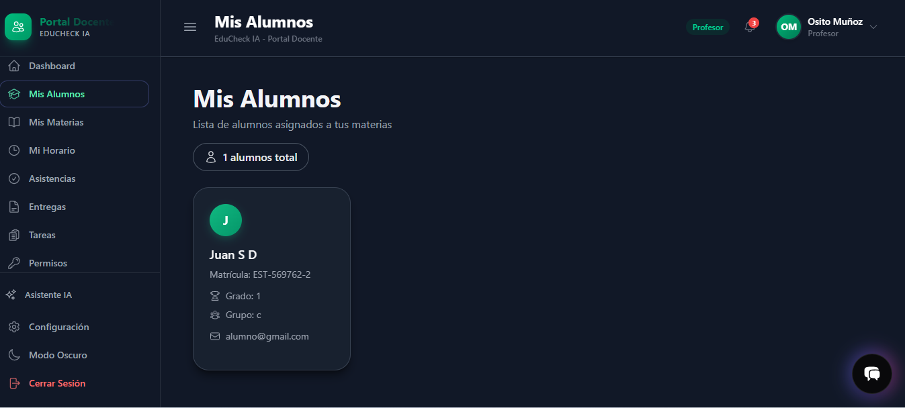
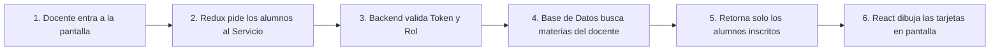

# Documentación Técnica: Módulo "Mis Alumnos" (Portal Docente)

**Sistema:** EduCheck AI  
**Módulo:** Portal Docente &rarr; Mis Alumnos  
**Ruta en la aplicación:** `/teacher/students`  
**Rol con acceso:** Docentes (`profesor`, `maestro`)  
**Stack principal:** React 19 + Tailwind CSS 4, Redux Toolkit, Node.js + Express, PostgreSQL  

---

## 1. ¿Qué es este módulo y para qué sirve?

El módulo **"Mis Alumnos"** es el espacio dentro del portal docente donde los profesores pueden ver de forma rápida y clara a todos los estudiantes que tienen asignados en sus distintas materias y grupos.

La pantalla está pensada para ser ágil: carga la información en segundo plano, muestra tarjetas individuales con los datos esenciales de cada alumno (nombre, matrícula, grado, grupo y correo) y garantiza que ningún profesor pueda ver alumnos que no pertenezcan a sus clases.

{: width="860px"}

## 2. ¿Cómo funciona por dentro? (Flujo de Datos)

El flujo de información desde que el profesor entra a la página hasta que ve a sus alumnos sigue estos pasos:

### Paso a paso:
1. **El usuario abre la vista:** React monta el componente `TeacherStudents.jsx`.
2. **Petición asíncrona:** A través de Redux Toolkit (`fetchMyStudents`), se llama a la función `getMyStudents()` del servicio frontend.
3. **Validación de seguridad:** La petición viaja al backend con un Token JWT en la cabecera. El servidor comprueba dos cosas:
   - Que el usuario tenga sesión activa y no esté suspendido (`protect`).
   - Que tenga permisos de profesor (`teacher`).
4. **Filtro de seguridad en la Base de Datos:** El backend **no** confía en datos enviados por el usuario. Toma el ID del profesor directamente del token, busca qué materias da en la escuela y consulta únicamente los alumnos matriculados en esas materias.
5. **Respuesta y renderizado:** Los datos regresan en formato JSON, Redux actualiza su estado y la pantalla dibuja las tarjetas correspondientes.

---

## 4. Estructura del Backend (Lado del Servidor)

El backend sigue el patrón **MVC** (Rutas &rarr; Controladores &rarr; Base de Datos).

### 4.1 Endpoints disponibles

| Método | Endpoint | ¿Qué hace? |
| :--- | :--- | :--- |
| `GET` | `/api/teacher/students` | Devuelve todos los alumnos que toman alguna materia con el profesor conectado. |
| `GET` | `/api/teacher/students/subject/:subjectId` | Devuelve los alumnos de una sola materia con sus horarios de clase. |
| `GET` | `/api/teacher/students/stats` | Devuelve el total de alumnos y cuántos hay por cada grado y grupo. |
| `GET` | `/api/teacher/students/:studentId` | Muestra el detalle de un alumno específico (validando que sea alumno suyo). |

### 4.2 La regla de oro de la seguridad (¿Cómo se aíslan los datos?)
Para evitar que un profesor pueda ver alumnos de otros grupos o escuelas, el controlador `teacherStudentsController.js` aplica una consulta en cadena:
1. Lee `req.user.user_id` desde el token verificado.
2. Obtiene el ID del profesor en la tabla `teachers`.
3. Busca las materias que tiene asignadas en `subjects`.
4. Si no tiene materias, responde de inmediato con una lista vacía `[]`.
5. Si tiene materias, busca en `enrollments` los alumnos inscritos exclusivamente en esas materias y une la información con las tablas `students` y `users`.
6. Usa `SELECT DISTINCT` para que si un alumno lleva dos materias con el mismo docente, aparezca una sola vez en la lista general.

---

## 5. Estructura del Frontend (Lado del Cliente)

El frontend está organizado por dominios dentro de `frontend/src/`:

### 5.1 Enrutamiento y Protección
- **Archivo:** `core/router/index.js`
- **Ruta:** `/teacher/students` (asociada a `TeacherStudents.jsx`).
- **Protección (`ProtectedRoute.jsx`):** Si un usuario no ha iniciado sesión o no tiene el rol de `profesor`/`maestro`, el sistema no le permite ver la pantalla y lo redirige al login.

### 5.2 Servicio de API (`teacherStudentsService.js`)
- Realiza la llamada HTTP `GET` usando `fetchWithTimeout`.
- Si el servidor tarda más de 5 segundos en responder, cancela la petición para no bloquear la aplicación.
- Si el token expiró (código 401/403), cierra la sesión automáticamente y envía al usuario al login.

### 5.3 Manejo de Estado con Redux (`teacherStudentsSlice.js`)
Maneja de forma automática los 3 momentos clave de la consulta:
- **`pending` (Cargando):** Enciende el indicador de carga para mostrar un spinner en pantalla.
- **`fulfilled` (Éxito):** Guarda la lista de alumnos recibida y apaga el indicador de carga.
- **`rejected` (Error):** Guarda el mensaje de error para que la pantalla pueda mostrar una alerta visible.

### 5.4 La pantalla (`TeacherStudents.jsx`)
Maneja de forma inteligente lo que ve el usuario según la situación:
- **Si está cargando:** Muestra un spinner animado con el texto *"Cargando alumnos..."*.
- **Si hubo un problema:** Muestra una caja de alerta roja con el mensaje de error.
- **Si no tiene alumnos:** Muestra un icono de birrete con el mensaje *"No tienes alumnos asignados"*.
- **Si tiene alumnos:** Muestra la cuadrícula de tarjetas con toda su información.

---

## 6. Guía Rápida de Archivos para Desarrolladores

Si necesitas consultar, mantener o hacer cambios en este módulo, estos son los archivos clave:

| Capa | Archivo | Responsabilidad |
| :--- | :--- | :--- |
| **Backend: Rutas** | `backend/routes/teacher/teacher.index.routes.js` | Define las URL de la API y les aplica los middlewares de autenticación. |
| **Backend: Controlador** | `backend/controllers/teacher/teacherStudentsController.js` | Contiene las consultas a la base de datos y la lógica para filtrar por profesor. |
| **Backend: Seguridad** | `backend/middleware/authMiddleware.js` | Verifica el token JWT (`protect`) y valida el rol de profesor (`teacher`). |
| **Frontend: Pantalla** | `frontend/src/domains/teachers/pages/ViewTeacher/TeacherStudents.jsx` | Componente visual que dibuja las tarjetas, el encabezado y los estados de carga. |
| **Frontend: Estado** | `frontend/src/domains/teachers/store/teacherStudentsSlice.js` | Slice de Redux Toolkit con los estados `list`, `isLoading` y `error`. |
| **Frontend: Servicio** | `frontend/src/domains/teachers/services/teacherStudentsService.js` | Funciones para comunicarse con los endpoints del backend. |
| **Frontend: Menús** | `frontend/src/config/menuItems.js` y `layoutConfigs.js` | Configuración de los accesos del menú lateral y títulos de la barra superior. |
