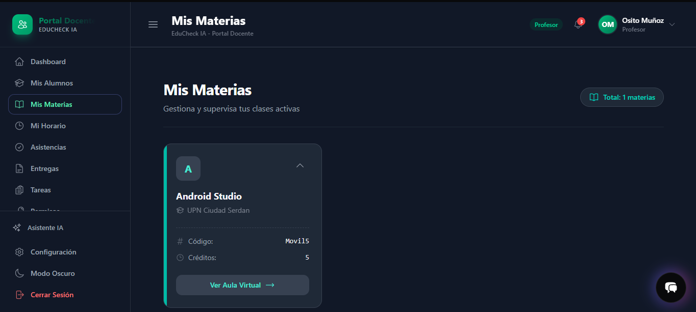
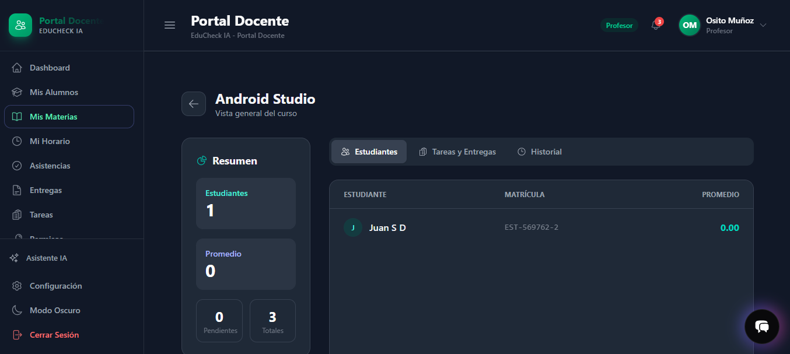
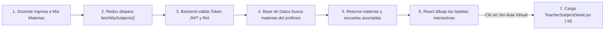

# Documentación Técnica: Módulo "Mis Materias" (Portal Docente)

**Sistema:** EduCheck AI  
**Módulo:** Portal Docente &rarr; Mis Materias / Aula Virtual  
**Ruta en la aplicación:** `/teacher/subjects` (Catálogo de materias) y `/teacher/subjects/:id` (Aula virtual y detalle)  
**Rol con acceso:** Docentes (`profesor`, `maestro`)  
**Stack principal:** React 19 + Tailwind CSS 4, Redux Toolkit, Node.js + Express, PostgreSQL  

## 1. ¿Qué es este módulo y para qué sirve?

El módulo **"Mis Materias"** es el centro de control académico del docente en EduCheck AI. Desde aquí, el profesor visualiza todas las asignaturas activas que tiene asignadas en la institución, supervisa a qué escuela o plantel pertenecen y accede al **Aula Virtual** de cada materia para consultar la lista de estudiantes inscritos, tareas asignadas, promedios y el historial reciente de actividades.

El diseño sigue una estética Dark Mode limpia y moderna, con tarjetas interactivas que destacan el estado de cada asignatura y botones de acceso directo a sus aulas virtuales.


{: width="860px"}

{: width="860px"}

## 2. ¿Cómo funciona por dentro? (Flujo de Datos)

El intercambio de datos desde que el docente carga la vista hasta que interactúa con sus clases funciona de la siguiente manera:



### Paso a paso del ciclo:
1. **Montaje de la pantalla:** `TeacherSubjects.jsx` se monta y ejecuta `dispatch(fetchMySubjects())` en su `useEffect`.
2. **Llamada HTTP:** El servicio `teacherSubjectsService.js` envía una solicitud `GET` a `/api/teacher/subjects` con la cabecera `Authorization: Bearer <token>`.
3. **Control de Seguridad:** Los middlewares `protect` y `teacher` certifican que la sesión sea válida y pertenezca a un profesor activo.
4. **Consulta con Scoping Estricto:** El backend extrae el ID del usuario del token, localiza su registro de docente y consulta exclusivamente las materias donde `teacher_id` coincida con su identidad, uniendo la tabla de escuelas para incluir el plantel correspondiente.
5. **Renderizado React:** Redux actualiza el listado y la interfaz genera las tarjetas en una cuadrícula responsiva con animaciones de Framer Motion.
6. **Navegación al Aula Virtual:** Al hacer clic en "Ver Aula Virtual", se navega a `/teacher/subjects/:id`, donde se consultan los alumnos inscritos, tareas, historial y promedios generales de esa clase.

## 3. Estructura del Backend (Lado del Servidor)

El backend implementa el patrón **MVC** y protege la información mediante validaciones relacionales directas.

### 3.1 Endpoints del módulo

| Método | Endpoint | ¿Qué hace? | Respuesta exitosa |
| :--- | :--- | :--- | :--- |
| `GET` | `/api/teacher/subjects` | Retorna todas las materias asignadas al profesor autenticado con su escuela asociada. | `200 OK` (Array de materias con código, créditos, estado y escuela). |
| `GET` | `/api/teacher/subjects/:materia_id` | Retorna el detalle completo del Aula Virtual (alumnos inscritos, tareas, historial y estadísticas). | `200 OK` (Objeto de materia con arrays de estudiantes, tareas, métricas e historial). |

### 3.2 La regla de oro de la seguridad (Aislamiento de materias)
En `teacherSubjectsController.js`, ningún profesor puede ver o alterar materias ajenas:
1. **Helper `getProfesorIdByUserId(user_id)`:** Resuelve internamente el `teacher_id` usando el `req.user.user_id` del token JWT verificado:
   ```sql
   SELECT teacher_id FROM teachers WHERE user_id = ?
   ```
2. **Listado general protegido:** La consulta principal filtra con rigor:
   ```sql
   SELECT m.*, e.school_name AS escuela_nombre
   FROM subjects m
   LEFT JOIN schools e ON m.school_id = e.school_id
   WHERE m.teacher_id = ?
   ```
3. **Validación de propiedad en el detalle:** Al consultar una materia específica por ID (`:materia_id`), la consulta exige doble coincidencia:
   ```sql
   WHERE m.teacher_id = ? AND m.subject_id = ?
   ```
   Si la materia existe en la escuela pero no le pertenece al docente solicitante, el backend arroja error 404/403: *"Materia no encontrada o no asignada a este profesor"*.

---

## 4. Estructura del Frontend (Lado del Cliente)

El frontend está estructurado dentro de `frontend/src/` bajo arquitectura de dominios:

### 4.1 Enrutamiento y Protección
- **Archivo:** `core/router/index.js`
- **Rutas registradas:**
  - `/teacher/subjects` &rarr; Carga diferida de `TeacherSubjects.jsx`.
  - `/teacher/subjects/:id` &rarr; Carga diferida de `TeacherSubjectDetail.jsx` (Aula Virtual).
- **Protección (`ProtectedRoute.jsx`):** Exige autenticación activa y verifica que el rol sea `profesor` o `maestro`.

### 4.2 Servicio de API (`teacherSubjectsService.js`)
- `getSubjectsByTeacher()`: Ejecuta la petición al endpoint `/teacher/subjects`.
- `getSubjectDetailByTeacher(materiaId)`: Solicita la información extendida de la clase para el aula virtual.
- Usa `handleResponse` y `getHeaders` desde `core/api/apiConfig.js` para adjuntar el token JWT y capturar caídas de sesión.

### 4.3 Manejo de Estado Global con Redux (`teacherSubjectsSlice.js`)
El slice almacena:
- `list`: Colección de materias asignadas para el catálogo principal.
- `currentSubject`: Detalle de la materia seleccionada para el Aula Virtual (con estudiantes, tareas y métricas).
- `isLoading`: Estado de carga booleano para mostrar esqueletos (*skeletons*) o spinners.
- `error`: Mensaje de error en caso de fallo de red o autorización.

### 4.4 Componentes de Vista
1. **Catálogo (`TeacherSubjects.jsx`):**
   - **Cargando:** Despliega bloques con efecto de pulso (*pulse skeleton*).
   - **Vacío:** Si el profesor no tiene clases, muestra un icono de libro con el mensaje *"No tienes materias asignadas"*.
   - **Con datos:** Renderiza la cuadrícula de tarjetas con soporte para expandir detalles (código y créditos) y botón de navegación.
2. **Aula Virtual (`TeacherSubjectDetail.jsx`):**
   - **Tarjetas de resumen rápido:** Total de alumnos inscritos, promedio general del grupo, tareas pendientes y tareas totales.
   - **Pestañas interactivas:**
     - *Estudiantes:* Lista de alumnos matriculados con su matrícula y calificación promedio actual.
     - *Tareas y Entregas:* Actividades del curso con fecha límite y estado de entrega grupal.
     - *Historial:* Línea de tiempo con los últimos eventos registrados (tareas creadas, calificaciones actualizadas).

## 6. Guía Rápida de Archivos para Desarrolladores

Para consultar o modificar cualquier aspecto de este módulo, dirígete a los siguientes archivos:

| Capa | Archivo | Responsabilidad |
| :--- | :--- | :--- |
| **Backend: Rutas** | `backend/routes/teacher/teacher.index.routes.js` | Expone los endpoints de materias y asocia los middlewares `protect` y `teacher`. |
| **Backend: Controlador** | `backend/controllers/teacher/teacherSubjectsController.js` | Resuelve el ID del profesor, consulta las materias en PostgreSQL y arma las métricas del aula virtual. |
| **Backend: Seguridad** | `backend/middleware/authMiddleware.js` | Valida el token JWT y confirma los privilegios de docente. |
| **Frontend: Pantalla Principal** | `frontend/src/domains/teachers/pages/ViewTeacher/TeacherSubjects.jsx` | Catálogo visual de materias con tarjetas, indicador activo y contador. |
| **Frontend: Aula Virtual** | `frontend/src/domains/teachers/pages/ViewTeacher/TeacherSubjectDetail.jsx` | Vista detallada de la materia con pestañas de alumnos, tareas, estadísticas e historial. |
| **Frontend: Estado** | `frontend/src/domains/teachers/store/teacherSubjectsSlice.js` | Slice de Redux Toolkit para gestionar el catálogo y la materia activa. |
| **Frontend: Servicio** | `frontend/src/domains/teachers/services/teacherSubjectsService.js` | Funciones de llamada HTTP hacia la API. |
| **Frontend: Enrutamiento** | `frontend/src/core/router/index.js` | Configuración de las rutas `/teacher/subjects` y `/teacher/subjects/:id`. |
