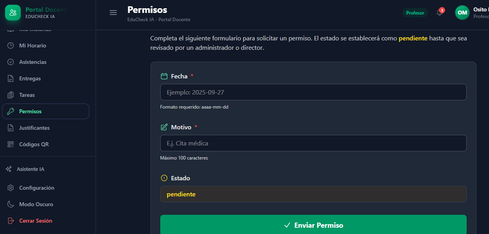
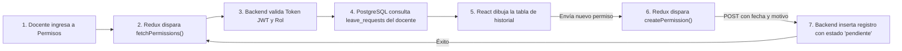

# Documentación Técnica: Módulo "Permisos" (Portal Docente)

**Sistema:** EduCheck AI  
**Módulo:** Portal Docente &rarr; Permisos / Solicitud y Consulta de Permisos  
**Ruta en la aplicación:** `/teacher/permissions`  
**Rol con acceso:** Docentes (`profesor`, `maestro`)  
**Stack principal:** React 19 + Tailwind CSS 4, Redux Toolkit, Node.js + Express, PostgreSQL  

## 1. ¿Qué es este módulo y para qué sirve?

El módulo **"Permisos"** es el canal formal de comunicación administrativa entre el docente y la dirección escolar en EduCheck AI. A través de este espacio, el profesor solicita justificaciones de ausencia laboral por causas personales, médicas o institucionales, indicando la fecha de inasistencia y el motivo de la solicitud.

Asimismo, la pantalla permite auditar en tiempo real el historial de permisos solicitados, revisar si se encuentran en estado **pendiente**, **aprobado** o **rechazado**, y consultar las observaciones o notas emitidas por el personal administrativo o directivo tras su evaluación.

{: width="860px"}

### Elementos principales de la pantalla:
1. **Sección Superior: Solicitud de Permiso (`PermissionForm.jsx`):**
   - **Título y Nota Informativa:** Explica con claridad que toda nueva solicitud iniciará con estado *pendiente* hasta ser evaluada.
   - **Campo Fecha:** Input con icono de calendario (`CalendarIcon`), formato estricto `aaaa-mm-dd` y validación de texto requerido.
   - **Campo Motivo:** Input con icono de lápiz (`PencilSquareIcon`), límite de hasta 100 caracteres y ejemplos orientativos (*"Cita médica"*).
   - **Campo Estado (Protegido):** Campo de solo lectura estilizado en tono ámbar suave que indica de forma transparente el estado inicial (`"pendiente"`).
   - **Botón de Envío:** Botón verde esmeralda ancho (`bg-emerald-600`) que bloquea pulsaciones repetidas mientras se procesa la solicitud (`"Enviando..."`).
2. **Sección Inferior: Historial de Permisos (`PermissionList.jsx`):**
   - **Tabla Responsiva:** Muestra el listado de solicitudes ordenadas de la más reciente a la más antigua.
   - **Columna Fecha:** Fecha efectiva del permiso en formato legible (`YYYY-MM-DD`).
   - **Columna Motivo:** Explicación provista por el docente.
   - **Columna Estado (Badges dinámicos):**
     - 🟡 **Pendiente:** Fondo ámbar claro con icono de reloj (`ClockIcon`).
     - 🟢 **Aprobado:** Fondo verde esmeralda con icono de verificación (`CheckCircleIcon`).
     - 🔴 **Rechazado:** Fondo rojo suave con icono de cruz (`XCircleIcon`).
   - **Columna Observaciones:** Notas de retroalimentación emitidas por la dirección escolar (o texto en cursiva *"Sin observaciones"* si aún no hay comentarios).
3. **Navegación General (Sidebar y Navbar):**
   - Menú lateral con **Permisos** (`KeyIcon`) resaltado como ruta activa.
   - Barra superior con rol ("Profesor"), notificaciones y avatar del docente ("Osito Muñoz").

---

## 3. ¿Cómo funciona por dentro? (Flujo de Datos)

El intercambio de datos desde que el profesor consulta o envía un permiso sigue estos pasos:



### Paso a paso:
1. **Carga inicial:** `PermissionList.jsx` despacha `fetchPermissions()` al montarse en el navegador.
2. **Autenticación en Backend:** La petición `GET` viaja a `/api/teacher/permissions` con el encabezado `Authorization: Bearer <token>`. Los middlewares `protect` y `teacher` validan la sesión activa y el rol docente.
3. **Consulta relacional en PostgreSQL:** El servidor busca exclusivamente en la tabla `leave_requests` los permisos asociados al `teacher_id` del usuario autenticado.
4. **Envío de solicitud:** Al enviar el formulario en `PermissionForm.jsx`, la fecha se normaliza al estándar ISO `YYYY-MM-DD` y se envía un `POST` con `{ fecha, motivo }`.
5. **Inserción protegida:** El backend inserta la fila vinculando el `teacher_id` del token y asigna por defecto `status = 'pendiente'` y `notes = ''`.
6. **Sincronización automática:** El thunk de Redux refresca la lista inmediatamente tras la creación exitosa, actualizando la tabla sin requerir que el usuario recargue la página.

---

## 4. Estructura del Backend (Lado del Servidor)

El backend implementa el patrón **MVC** y expone las rutas en `backend/routes/teacher/teacher.index.routes.js` bajo el prefijo `/api/teacher`.

### 4.1 Endpoints del módulo

| Método | Endpoint | Middleware | ¿Qué hace? |
| :--- | :--- | :--- | :--- |
| `GET` | `/api/teacher/permissions` | `protect`, `teacher` | Retorna todos los permisos del docente autenticado ordenados cronológicamente por fecha (`request_date DESC`). |
| `POST` | `/api/teacher/permissions` | `protect`, `teacher` | Crea una nueva solicitud de permiso con estado inicial `pendiente`. |

### 4.2 La regla de oro de la seguridad (Aislamiento de permisos)
En `teacherPermissionController.js`, ningún docente puede consultar ni registrar permisos a nombre de otro colega:
1. **Resolución de Identidad:** Obtiene el `profesor_id` exclusivamente del token JWT verificado:
   ```sql
   SELECT teacher_id FROM teachers WHERE user_id = ?
   ```
2. **Listado de permisos con Scoping estricto:**
   ```sql
   SELECT * FROM leave_requests WHERE teacher_id = ? ORDER BY request_date DESC
   ```
   La capa de compatibilidad de PostgreSQL (`backend/config/Postgres/db.js`) traduce automáticamente las columnas a nombres familiares en español (`permiso_id`, `profesor_id`, `fecha`, `motivo`, `estado`, `observaciones`).
3. **Creación con valores predeterminados seguros:**
   ```sql
   INSERT INTO leave_requests (teacher_id, request_date, reason, status, notes) 
   VALUES (?, ?, ?, ?, ?)
   ```
   El backend fuerza que `status` sea `'pendiente'` y `notes` comience vacío, impidiendo que el cliente intente autoaprobarse un permiso enviando parámetros manipulados en el cuerpo de la petición.

---

## 5. Estructura del Frontend (Lado del Cliente)

El módulo se encuentra en el dominio de profesores (`frontend/src/domains/teachers/`):

### 5.1 Enrutamiento y Protección
- **Archivo:** `core/router/index.js`
- **Ruta declarada:** `/teacher/permissions` (carga diferida de `TeacherPermissions.jsx`).
- **Protección (`ProtectedRoute.jsx`):** Exige autenticación activa y verifica roles autorizados `['profesor', 'maestro']`.
- **Menú de navegación:** Enlazado en `menuItems.js` con el texto *"Permisos"* y el icono `KeyIcon`.

### 5.2 Servicio de API (`teacherPermissionService.js`)
- `fetchTeacherPermissions()`: Realiza el `GET` a `${API_BASE_URL}/teacher/permissions`.
- `createTeacherPermission(data)`: Realiza el `POST` con cabeceras `Content-Type: application/json` y `Authorization: Bearer <token>`.
- Emplea `fetchWithTimeout` y `handleResponse` para interceptar automáticamente credenciales caducadas.

### 5.3 Gestión de Estado Global con Redux (`teacherPermissionSlice.js`)
El slice centraliza el estado bajo la clave `teacherPermissions`:
- `items`: Arreglo con la lista de permisos solicitados.
- `loading`: Indicador booleano de carga para formularios y tablas.
- `error`: Contenedor de mensajes de error devueltos por el servidor.
- **Thunks Asíncronos:**
  - `fetchPermissions`: Consulta la lista de permisos del profesor.
  - `createPermission`: Envía el nuevo permiso y, al confirmarse, dispara una recarga automática de los items para mantener la UI sincronizada.

### 5.4 Componentes de la Vista
1. **Contenedor Principal (`TeacherPermissions.jsx`):** Estructura el layout en dos bloques verticales limpios (formulario arriba, historial abajo) dentro de `TeacherLayout`.
2. **Formulario (`PermissionForm.jsx`):** Valida la presencia de datos, normaliza la fecha al formato ISO requerido, muestra alertas de éxito o error y resetea los campos tras un envío exitoso.
3. **Tabla de Historial (`PermissionList.jsx`):** Maneja los estados visuales (*cargando*, *error*, *vacío* y *tabla con datos*), formateando dinámicamente los badges de estado con colores intuitivos para el docente.

---

## 6. Guía Rápida de Archivos para Desarrolladores

Para revisar, auditar o extender el módulo de permisos, consulta los siguientes archivos:

| Capa | Archivo | Responsabilidad |
| :--- | :--- | :--- |
| **Backend: Rutas** | `backend/routes/teacher/teacher.index.routes.js` | Registra los endpoints `/permissions` con middlewares `protect` y `teacher`. |
| **Backend: Controlador** | `backend/controllers/teacher/teacherPermissionController.js` | Resuelve el ID del docente, consulta `leave_requests` y registra nuevas solicitudes con estado `pendiente`. |
| **Backend: Seguridad** | `backend/middleware/authMiddleware.js` | Validación de token JWT (`protect`) y autorización de rol docente (`teacher`). |
| **Frontend: Pantalla Principal** | `frontend/src/domains/teachers/pages/ViewTeacher/TeacherPermissions.jsx` | Vista integradora con secciones de solicitud e historial. |
| **Frontend: Formulario** | `frontend/src/domains/teachers/components/ViewTeacher/PermissionForm.jsx` | Captura de fecha y motivo con validación de formato y feedback visual. |
| **Frontend: Lista de Historial** | `frontend/src/domains/teachers/components/ViewTeacher/PermissionList.jsx` | Tabla de permisos con badges semafóricos (pendiente, aprobado, rechazado). |
| **Frontend: Estado** | `frontend/src/domains/teachers/store/teacherPermissionSlice.js` | Slice de Redux Toolkit con thunks `fetchPermissions` y `createPermission`. |
| **Frontend: Servicio** | `frontend/src/domains/teachers/services/teacherPermissionService.js` | Llamadas HTTP hacia los endpoints de permisos. |
| **Frontend: Enrutamiento** | `frontend/src/core/router/index.js` | Registro de la ruta protegida `/teacher/permissions`. |
