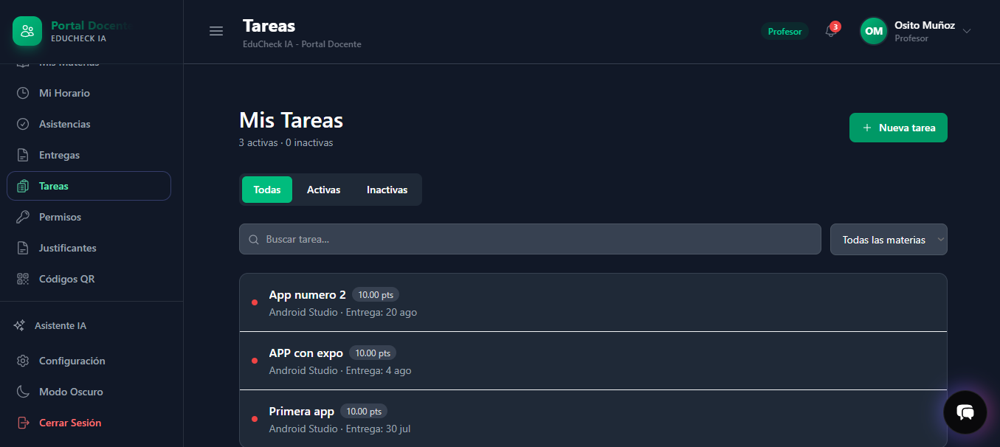

# Documentación Técnica: Módulo "Tareas" (Portal Docente)

**Sistema:** EduCheck AI  
**Módulo:** Portal Docente &rarr; Tareas / Gestión de Actividades  
**Ruta en la aplicación:** `/teacher/tasks` (Catálogo y gestión) y `/teacher/tasks/:id` (Detalle y edición de tarea)  
**Rol con acceso:** Docentes (`profesor`, `maestro`)  
**Stack principal:** React 19 + Tailwind CSS 4, useReducer (Estado local reactivo) + Framer Motion, Node.js + Express, PostgreSQL  


## 1. ¿Qué es este módulo y para qué sirve?

El módulo **"Tareas"** es el centro de asignación y administración de actividades académicas del profesor en EduCheck AI. Desde aquí, el docente crea, programa, consulta, edita y elimina las tareas de todas las materias que tiene a su cargo en la institución.

La interfaz ofrece una vista rápida y limpia con soporte para temas claro y oscuro, un contador dinámico de tareas activas e inactivas, un sistema de pestañas para filtrar por estado, un buscador en vivo por título o descripción, un selector por materia, indicadores visuales de proximidad de entrega (semáforo por colores según los días restantes) y un modal interactivo para crear o modificar tareas sin abandonar la página.

{: width="860px"}

### Elementos principales de la pantalla:
1. **Encabezado y Acciones Principales:**
   - **Título y Resumen de Estado:** Muestra "Mis Tareas" acompañado del conteo en tiempo real (`3 activas · 0 inactivas`).
   - **Botón "+ Nueva tarea":** Botón verde esmeralda (`bg-emerald-600`) que abre el modal de creación rápida con selector de materia, título, descripción, fechas y puntos.
2. **Pestañas y Filtros de Búsqueda:**
   - **Selector de Estado:** Pestañas tipo pastilla (*Todas*, *Activas*, *Inactivas*), destacando la activa con fondo verde esmeralda y sombra suave.
   - **Buscador en Vivo:** Input con icono de lupa (`MagnifyingGlassIcon`) que filtra instantáneamente por título o descripción.
   - **Selector de Materia:** Menú desplegable con las materias asignadas al docente para acotar la lista a una clase específica.
3. **Lista de Tarjetas de Tarea:**
   - **Indicador Semafórico de Entrega:** Punto circular de color que advierte el tiempo restante:
     - 🔴 **Rojo:** Fecha límite vencida (`días < 0`).
     - 🟡 **Ámbar:** Entrega próxima (3 días o menos).
     - 🟢 **Verde:** Entrega con tiempo suficiente (más de 3 días).
   - **Título y Puntaje:** Título de la actividad en negrita junto a una píldora con el valor asignado (ejemplo: `10.00 pts`).
   - **Metadatos:** Materia a la que pertenece y fecha límite de entrega formateada (ejemplo: `Android Studio · Entrega: 20 ago`).
   - **Navegación al Detalle:** Al hacer clic en cualquier tarea, navega a `/teacher/tasks/:id` para ver la descripción completa, editar datos o eliminar la actividad.
4. **Navegación General (Sidebar y Navbar):**
   - Menú lateral con **Tareas** (`ClipboardDocumentListIcon`) resaltado como ruta activa.
   - Barra superior con título de página, rol ("Profesor"), notificaciones y avatar del docente ("Osito Muñoz").

---

## 3. ¿Cómo funciona por dentro? (Flujo de Datos)

El intercambio de datos desde que el docente ingresa hasta que crea o edita una tarea sigue estos pasos:

```mermaid
flowchart LR
    A["1. Docente entra a Mis Tareas"] --> B["2. useReducer solicita tareas y materias"]
    B --> C["3. Backend valida Token JWT y Rol"]
    C --> D["4. Base de Datos filtra tareas del profesor"]
    D --> E["5. React calcula días restantes y dibuja la lista"]
    E -->|Nueva tarea / Editar| F["6. TaskFormModal envía POST o PUT"]
    F -->|Éxito| G["7. Se actualiza la lista al instante"]
```



### Paso a paso:
1. **Carga inicial:** Al montarse `TeacherTasks.jsx`, se dispara `fetchTasksList()`, que consulta en paralelo las tareas del profesor y su catálogo de materias disponibles.
2. **Autenticación en Backend:** La llamada viaja hacia `/api/teacher/tasks` con el encabezado `Authorization: Bearer <token>`. Los middlewares `protect` y `teacher` validan la identidad y el rol activo.
3. **Aislamiento en Base de Datos:** El servidor extrae el `teacher_id` del token y ejecuta la consulta relacional con `subjects`, garantizando que el profesor solo reciba las tareas de sus materias.
4. **Cálculo de semáforo en cliente:** React compara la fecha de entrega con la fecha actual mediante `getDaysRemaining` y asigna la clase CSS correspondiente al indicador circular.
5. **Creación o Edición:** Al enviar el formulario de `TaskFormModal`, se ejecuta `createTeacherTask` (`POST`) o `updateTeacherTask` (`PUT`), cerrando el modal y refrescando la vista sin recargar la página.

---

## 4. Estructura del Backend (Lado del Servidor)

El backend implementa el patrón **MVC** y expone las rutas en `backend/routes/teacher/teacherTask.routes.js`, montadas bajo `/api/teacher/tasks`.

### 4.1 Endpoints del módulo

| Método | Endpoint | Middleware | ¿Qué hace? |
| :--- | :--- | :--- | :--- |
| `GET` | `/api/teacher/tasks` | `protect`, `teacher` | Retorna todas las tareas (activas e inactivas) de las materias que imparte el profesor. |
| `GET` | `/api/teacher/tasks/:tarea_id` | `protect`, `teacher` | Retorna el detalle completo de una tarea específica con el nombre de su materia. |
| `POST` | `/api/teacher/tasks` | `protect`, `teacher` | Crea una nueva tarea asignada a una materia del profesor con `RETURNING assignment_id`. |
| `PUT` | `/api/teacher/tasks/:tarea_id` | `protect`, `teacher` | Actualiza título, descripción, fechas, puntaje o estado de una tarea existente. |
| `DELETE` | `/api/teacher/tasks/:tarea_id` | `protect`, `teacher` | Elimina definitivamente una tarea si pertenece a una materia del profesor. |

### 4.2 La regla de oro de la seguridad (Aislamiento de tareas)
En `teacherTaskController.js`, ningún docente puede interactuar con tareas de clases ajenas:
1. **Resolución de Identidad:** Obtiene el `profesor_id` exclusivamente desde el token verificado:
   ```sql
   SELECT teacher_id FROM teachers WHERE user_id = ?
   ```
2. **Listado general protegido con JOIN:**
   ```sql
   SELECT t.*, m.name AS materia_nombre 
   FROM assignments t
   JOIN subjects m ON t.subject_id = m.subject_id
   WHERE m.teacher_id = ?
   ORDER BY t.is_active DESC, t.due_date DESC
   ```
3. **Validación previa en creación:** Antes de insertar la tarea, verifica que la materia pertenezca al profesor:
   ```sql
   SELECT * FROM subjects WHERE subject_id = ? AND teacher_id = ?
   ```
   Si no coincide, deniega la operación con código `403 No autorizado para agregar tarea a esta materia`.
4. **Validación previa en edición y eliminación:** Tanto en `updateTask` como en `deleteTask`, valida la doble pertenencia (`t.assignment_id = ? AND m.teacher_id = ?`) para bloquear manipulaciones no autorizadas.

---

## 5. Estructura del Frontend (Lado del Cliente)

El frontend está estructurado en el dominio de profesores (`frontend/src/domains/teachers/`):

### 5.1 Enrutamiento y Protección
- **Archivo:** `core/router/index.js`
- **Rutas declaradas:**
  - `/teacher/tasks`: Catálogo principal de tareas (`TeacherTasks.jsx`).
  - `/teacher/tasks/:id`: Vista de detalle, edición y eliminación (`TeacherTaskDetail.jsx`).
- **Protección (`ProtectedRoute.jsx`):** Requiere sesión activa y permisos de docente (`profesor` o `maestro`).
- **Menú de navegación:** Enlazado en `menuItems.js` con el texto *"Tareas"* y el icono `ClipboardDocumentListIcon`.

### 5.2 Servicio de API (`teacherTaskService.js`)
- Expone las funciones asíncronas:
  - `fetchTeacherTasks(token)`
  - `createTeacherTask(token, taskData)`
  - `updateTeacherTask(token, tarea_id, taskData)`
  - `deleteTeacherTask(token, tarea_id)`
- Inyecta la cabecera `Authorization: Bearer <token>` y valida el código de respuesta HTTP.

### 5.3 Gestión de Estado Ágil con `useReducer`
Siguiendo la arquitectura moderna del portal docente, este módulo utiliza un **reducer local** en `TeacherTasks.jsx`:
- **Ventaja:** Evita sobrecargar el store global de Redux con estados efímeros de formularios, filtros de texto y modales.
- **Acciones principales:** `SET_DATA`, `SET_LOADING`, `SET_ERROR`, `SET_SEARCH`, `SET_FILTER_MATERIA`, `SET_FILTER_ESTADO`, `OPEN_MODAL`, `CLOSE_MODAL`, `UPDATE_FORM` y `SET_SUBMITTING`.
- **Filtros reactivos combinados:** Un `useEffect` evalúa en memoria la búsqueda por texto, la materia seleccionada y la pestaña de estado (*todas*, *activas*, *inactivas*) en milisegundos.

### 5.4 Componentes de la Vista
1. **Catálogo Principal (`TeacherTasks.jsx`):** Orquestador de la lista, contador de tareas, filtros por materia y semáforo de vencimiento.
2. **Modal de Formulario (`TaskFormModal.jsx`):** Modal con animaciones de Framer Motion (`LazyMotion`) para capturar materia, título, descripción, fecha de asignación, fecha de entrega y puntos máximos.
3. **Detalle de Tarea (`TeacherTaskDetail.jsx`):** Vista extendida con descripción detallada, contador de días restantes, modo de edición en línea y botón de eliminación.
4. **Diálogo de Confirmación (`TaskDeleteConfirmDialog.jsx`):** Modal de advertencia para prevenir eliminaciones accidentales de tareas.

---

## 6. Guía Rápida de Archivos para Desarrolladores

Para revisar, mantener o extender el módulo de tareas, consulta los siguientes archivos:

| Capa | Archivo | Responsabilidad |
| :--- | :--- | :--- |
| **Backend: Rutas** | `backend/routes/teacher/teacherTask.routes.js` | Endpoints REST bajo `/api/teacher/tasks` con middlewares `protect` y `teacher`. |
| **Backend: Controlador** | `backend/controllers/teacher/teacherTaskController.js` | Lógica de base de datos con PostgreSQL (consultas, inserciones con RETURNING, updates y deletes con validación de titularidad). |
| **Backend: Seguridad** | `backend/middleware/authMiddleware.js` | Validación de token JWT (`protect`) y confirmación de rol docente (`teacher`). |
| **Frontend: Pantalla Principal** | `frontend/src/domains/teachers/pages/ViewTeacher/TeacherTasks.jsx` | Lista de tareas, semáforo de entrega, pestañas de filtro y orquestación con `useReducer`. |
| **Frontend: Detalle de Tarea** | `frontend/src/domains/teachers/pages/ViewTeacher/TeacherTaskDetail.jsx` | Vista extendida de la tarea, edición inline y confirmación de eliminación. |
| **Frontend: Modal Formulario** | `frontend/src/domains/teachers/components/ViewTeacher/TaskFormModal.jsx` | Formulario modal para crear y editar tareas con animaciones suaves. |
| **Frontend: Modal Eliminar** | `frontend/src/domains/teachers/components/ViewTeacher/TaskDeleteConfirmDialog.jsx` | Diálogo modal de confirmación antes de eliminar una tarea. |
| **Frontend: Servicio** | `frontend/src/domains/teachers/services/teacherTaskService.js` | Peticiones HTTP (`GET`, `POST`, `PUT`, `DELETE`) hacia la API de tareas. |
| **Frontend: Enrutamiento** | `frontend/src/core/router/index.js` | Declaración de las rutas protegidas `/teacher/tasks` y `/teacher/tasks/:id`. |
