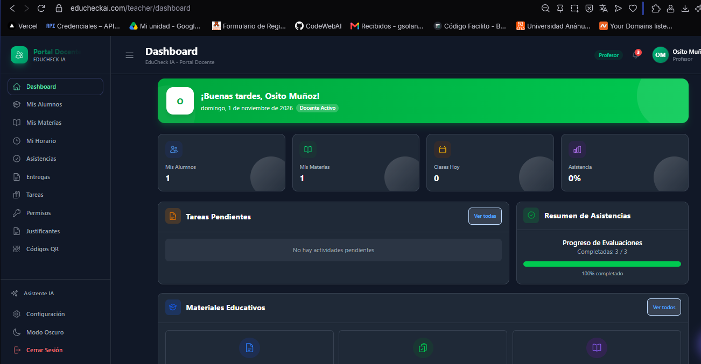

# ¿Que información vemos en el dashboard del profesor?

El panel del docente presenta información general, como la cantidad de alumnos, el número de materias, las clases programadas para el día y el porcentaje global de asistencia.

En la sección inferior se incluye un resumen de las tareas pendientes por calificar y el registro de asistencias.

Finalmente, cuenta con un apartado de accesos directos al material educativo utilizado por el profesor.

{: width="860px"}

## ¿Como esta construido el dashboard?

El Dashboard del Profesor es el panel principal donde los docentes pueden consultar de manera rápida y centralizada toda la información académica relevante: sus materias asignadas, la lista de alumnos, las clases programadas para el día y las tareas pendientes por calificar.

Para lograr esto, el sistema utiliza un flujo estructurado y seguro:

1. **Inicio de sesión**: Cuando el profesor ingresa al sistema, sus credenciales se validan y se genera una llave de acceso segura (un token JWT) que se almacena temporalmente en el navegador.

2. **Validación de identidad**: Cada vez que el profesor entra al panel, el sistema verifica mediante un filtro de seguridad (middleware) que la persona esté autenticada y cuente con el rol autorizado (profesor, maestro, director o administrador).

3. **Carga de datos**: El panel solicita simultáneamente varios bloques de información a la base de datos (estadísticas, clases del día, tareas pendientes, etc.) a través de conexiones seguras.

4. **Visualización**: Una vez que la información llega al navegador, se organiza y se muestra en la pantalla de forma visual y ordenada mediante tarjetas informativas.

### 1. **El Backend (El Cerebro del Sistema)**
El servidor se encarga de procesar las solicitudes, verificar la seguridad y extraer de la base de datos únicamente la información que le corresponde ver al profesor autenticado.

- **Punto de entrada (app.js):** Configura las rutas principales para que el sistema sepa dónde buscar la información relacionada con los docentes y su panel de control.

- **Seguridad y Accesos (authMiddleware.js):**

    - La función **protect** intercepta las solicitudes para comprobar que el usuario tenga una llave de acceso válida y activa. Si la llave no existe o expiró, rechaza el acceso.
    - La función teacher comprueba que el usuario tenga un rol permitido (como profesor o maestro) antes de dejarle ver el contenido.

- **Rutas del Panel (teacherDashboard.routes.js):** Define los accesos específicos para obtener métricas y resúmenes del profesor:

    - **GET /stats:** Muestra los totales de alumnos, materias, clases y asistencia general.
    - **GET /today-classes:** Lista las clases que el profesor tiene programadas para el día actual.
    - **GET /active-qrs:** Muestra los códigos QR activos para pase de lista.
    - **GET /attendance-summary:** Presenta un resumen de asistencia de los últimos siete días.
    - **GET /pending-activities:** Muestra las tareas que aún tienen entregas pendientes por revisar.
    - **GET /evaluation-progress:** Indica el avance porcentual de las evaluaciones.
    - **GET /reminders:** Muestra recordatorios y tareas próximas a vencer.

- **Otras funciones docentes relacionadas:** El sistema también cuenta con rutas secundarias (agrupadas en controladores como **teacherDashboardController.js** y **teacher.index.routes.js**) para administrar detalladamente materias, listados de alumnos, horarios y la creación o modificación de tareas.

### 2. **El Frontend (La Cara Visible)**
Es la parte gráfica con la que interactúa el profesor en su pantalla. Está diseñada para ser intuitiva y conectarse de forma fluida con el servidor.

- **Control de Rutas (router/index.js y ProtectedRoute.jsx):** Aseguran que la ruta del panel de control solo pueda ser visualizada si el usuario ha iniciado sesión correctamente y cuenta con el rol de profesor o maestro.

- **Gestión de Peticiones (teacherDashboardService.js):** Funciona como el mensajero encargado de solicitar al servidor los datos de estadísticas, clases del día y tareas pendientes.

- **Manejo de Datos y Estado (teacherDashboardSlice.js y core/store/index.js):** Organiza la información dentro de la aplicación para que esté disponible de inmediato. Se encarga de avisar cuando los datos se están cargando, si hubo algún error o si ya están listos para mostrarse.

- **Diseño Visual (TeacherDashboard.jsx):** Es el archivo principal de la interfaz visual. Al entrar a la sección, ejecuta la carga de los datos, muestra indicadores de carga o avisos en caso de error, y dibuja en la pantalla las tarjetas con toda la información del profesor (alumnos, materias, clases, tareas y progreso).

- **Configuración de Red (apiConfig.js):** Define las reglas generales para las peticiones web, añadiendo automáticamente la llave de seguridad del usuario, estableciendo un tiempo límite de espera y manejando posibles errores de acceso no autorizado.